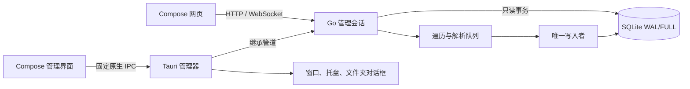

# 运行架构

产品由 Go 运行会话、Tauri 桌面宿主和 Kotlin Compose/WasmJS 两端界面组成。当前源码不再含 Node 后端、Electron 或旧 JavaScript CanvasKit 页面。技术决定见 [adr-9](adr-9-full_stack_migration.md)，在用生产尚未切换。

| 位置 | 职责 |
| --- | --- |
| cmd/gallery-runtime、internal/host | 管理器拥有的会话、HTTP、任务、配置、恢复与正常关闭 |
| internal/control、task、inspection | 原生身份、排他、任务取消、只读检查和报告 |
| internal/physical、library、metadata、indexing、catalog | 文件表/原生清单、九平台解析、有界准备和单 writer |
| internal/httpservice、reading、fileview、media、recovery | 公共读取协议、文件浏览、缩略图、媒体和恢复 |
| internal/searchquery、personal | 搜索语法与账号、收藏、阅读记录；个人库独立于目录单写者 |
| internal/physical | 短生命周期提权 NTFS 位置提取，不承载 HTTP，不保留范围外记录 |
| internal/webui | go:embed 的网页资源；构建产物不入库 |
| src-tauri | 薄桌面宿主、固定命令白名单、系统集成 |
| ui/src/commonMain | 路由、生成的接口类型、协议值、分页和更新通知模型 |
| ui/src/wasmJsMain | Compose 两端页面、主题、字体、Fluent 图标、媒体互操作 |
| api | 独立版本、平台合同、JSON Schema、DDL 与 SQL |
| tools、validations | 开发构建、合成生成、场景定义；不进入产品运行路径 |

`cmd/gallery-read`、`cmd/gallery-scan` 为既有开发验收入口，不进入发行目录。实际产品只能在管理器内启动服务和扫描。浏览器不访问数据库，Rust 不承担索引或查询业务。

个人数据边界与阅读模式见[个人阅读机制](mechanism-personal_reading.md)。

生成物、依赖缓存和实例均在仓外。字体资源在构建时复制，前端先构建，再构建 Go 和嵌入前端的 Tauri；具体入口见[开发流程](../development/workflow-development.md)。
